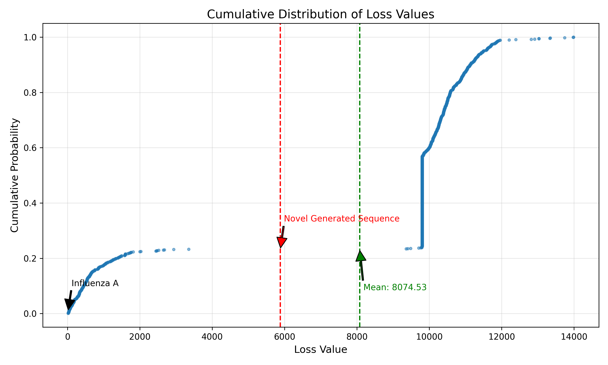

# Oncolytic Virus Generator

Can a machine learning model learn useful patterns in viral genomes and generate a sequence that might help fight cancer?

This project explores that question by combining an **LSTM sequence model**, a **custom stochastic simulator**, and **1,000 viral sequences** from NCBI. The experiment reported a generated sequence with a predicted simulation loss **27% below the dataset average**.

## Motivation

Oncolytic viruses are studied as a way to attack cancer cells while preserving healthy tissue. Their behavior depends in part on their genetic makeup, making genome sequences an interesting setting for machine learning.

The goal was to explore whether a model could learn from existing viral sequences and their simulated outcomes, then produce a new sequence with a favorable predicted score. It connects a familiar ML problem—learning patterns in sequences—with a biological question: which genome traits might be associated with useful outcomes?

## How It Works

### 1. Build a labeled dataset

The project retrieved 1,000 viral sequences and their annotations from the NCBI nucleotide database. Annotations describe genes and other features of a sequence. The dataset includes both genome segments and larger sequences.

Each sequence was evaluated using a custom simulator that tracks interactions among viruses, cancer cells, healthy cells, and immune cells. Random sampling drives the interactions and population changes, producing a numerical loss for each sequence.

The loss combines the simulated outcome, elapsed time, remaining viruses, and remaining immune cells. **Lower loss is better within this simulation.** These scores provide training labels without requiring experimental measurements.

### 2. Learn sequence patterns and predict loss

The PyTorch model uses a nucleotide embedding and a **two-layer LSTM** with two output heads:

- A sequence head predicts the next nucleotide.
- A regression head predicts the sequence's simulation loss.

Training combines next-token cross-entropy and mean squared error, optimized with Adam. This lets the model learn sequence patterns while also learning to estimate the simulation's score.

### 3. Generate a sequence

The active generation method samples from frequencies of three-base patterns, giving more weight to patterns found in sequences with lower losses. The LSTM supplies the learned loss predictor. The repository also includes an earlier generation method that samples directly from the LSTM.

## Results

| Metric | Value |
| --- | ---: |
| Sequences evaluated | 1,000 |
| Mean dataset simulation loss | 8,074.53 |
| Reported predicted loss for the generated sequence | 5,882.22 |
| Reduction relative to the dataset mean | **27.15%** |

The percentage is calculated as `(8,074.53 - 5,882.22) / 8,074.53`. It compares a reported prediction with the dataset's simulated scores. The generated sequence was not tested in the simulator or in biological experiments, so this result does not establish cancer-fighting effectiveness.



See the [project report](paper.pdf) for the experimental details, interpretation, and limitations.

## Repository Structure

| File or directory | Contents |
| --- | --- |
| [main.py](main.py) | Data retrieval, simulation, model training, and output generation. |
| [model/model.py](model/model.py) | LSTM, loss predictor, sequence-generation methods, and checkpoint utilities. |
| [simulation/](simulation/) | Stochastic interaction model and simulation scoring. |
| [analysis/](analysis/) | Loss-analysis script, CSV data, and figures. |
| [out.txt](out.txt) | Simulation results for the 1,000 input sequences. |
| [generated_sequence.txt](generated_sequence.txt) | Saved generated sequence and reported estimate. |
| [paper.pdf](paper.pdf) | Original project report. |

## Explore the Saved Results

The project uses Python, PyTorch, Biopython, NumPy, Matplotlib, and tqdm. To recreate the loss-distribution figure from the saved experiment, install the analysis dependencies and run from the repository root:

```bash
python -m pip install numpy matplotlib
python analysis/distribution.py
```

The script reads `out.txt` and writes `analysis/losses.csv` and `analysis/loss_distribution_cdf.png`. The saved data, generated sequence, and report can also be inspected directly without rerunning the experiment.
